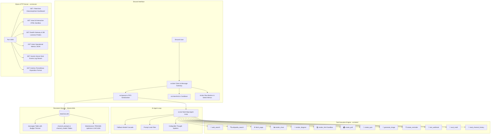

<div align="center">

# 🌟 Nova

**Autonomous AI Agent Discord Bot & Real-time Web Daemon**

[](https://github.com/rheatkhs/nova/actions)
[](https://bun.sh)
[](https://www.typescriptlang.org/)
[](https://discord.js.org/)
[](https://elysiajs.com/)
[](LICENSE)

<p align="center">
  <a href="#-architecture">Architecture</a> •
  <a href="#-key-features">Key Features</a> •
  <a href="#-quick-start">Quick Start</a> •
  <a href="#-commands--interaction">Commands</a> •
  <a href="#-tools-suite">Tools Suite</a> •
  <a href="#-status-api--observability">Observability</a> •
  <a href="#-deployment">Deployment</a>
</p>

</div>

---

## 🏛️ Architecture

Nova combines an asynchronous Discord Gateway client with an OpenAI-compatible multi-step agent loop, persistent SQLite conversation memory with WAL journals, and an Elysia HTTP observability microservice.



---

## ✨ Key Features

### 🤖 Intelligent Agent Core
- **Multi-Step Tool Calling:** Executes up to 5 sequential tools per query (e.g. searching Wikipedia, writing code, and generating a live preview).
- **Model Fallback Cascade:** Automatically switches to `AI_FALLBACK_MODEL` if the primary model hits upstream rate limits or outages.
- **Transient HTTP Retries:** Automatically handles `429` and `5xx` errors with exponential backoff.
- **Prompt Leak Protection:** Redacts verbatim attempts to extract internal system instructions.
- **Collapsible Reasoning:** Wraps chain-of-thought `<think>` blocks in clickable Discord spoiler blocks (`||💭 Thought: ...||`).

### 💬 Rich Discord Interactions
- **Thread Scoping:** Automatically treats bot-owned and discussion threads as active conversations without requiring `@mentions`.
- **Interactive Action Buttons:**
  - `🧵 Thread`: Spawns a dedicated discussion thread under the answer.
  - `📥 Code`: Extracts the primary code block and uploads it as a downloadable source file (`snippet.py`, `snippet.ts`, etc.).
  - `🔄 Regenerate`: Re-runs the question turn with the model and updates the reply in-place.
  - `📩 Save`: Sends a copy of the response with message jump-link directly to your private DMs.
  - `🗑️ Delete`: Deletes the response message (restricted to question author or moderators).
  - `🔊 Listen`: Generates an instant MP3 speech readout of the response.
- **Slash Commands & Autocomplete:** Real-time search for models and languages (`/model`, `/language`), modal GUI persona editor (`/prompt`), conversation recaps (`/reset recap:true`), and history exports (`/export`).
- **Context Menus:** Right-click any message $\to$ `Apps` $\to$ `Explain with Nova` or `Summarize with Nova`.
- **Reply Footers:** Native subtext displaying active model, round-trip latency (`ms`), and deduplicated tool badges (`🔎 web_search • 📊 render_chart`).

### 💾 Robust Persistence & Operations
- **Zero-Dependency SQLite:** Backed by Bun's native `bun:sqlite` with WAL mode and automated startup optimization (`PRAGMA optimize; VACUUM;`).
- **Dynamic Token-Budget Trimming:** Enforces a maximum character budget (`HISTORY_CHAR_LIMIT`), automatically pruning older messages while retaining recent context.
- **Full Observability:** Live SSE event stream on `/events`, interactive dark-mode dashboard on `/`, and Prometheus metrics on `/metrics`.

---

## 🚀 Quick Start

### Prerequisites
- [Bun](https://bun.sh) v1.2+ installed
- A Discord Bot Token with **Message Content Intent** enabled ([Discord Developer Portal](https://discord.com/developers/applications))

### Installation

```bash
# Clone repository
git clone https://github.com/rheatkhs/nova.git
cd nova

# Install dependencies (frozen lockfile)
bun install --frozen-lockfile

# Configure environment variables
cp .env.example .env
```

Edit `.env` with your credentials:
```env
DISCORD_TOKEN=your_bot_token_here
AI_BASE_URL=https://api.openai.com/v1
AI_API_KEY=your_api_key_here
AI_MODEL=gpt-4o-mini
```

### Run Daemon

```bash
# Start bot in production mode
bun start

# Start with hot-reloading for development
bun dev
```

---

## ⚙️ Configuration Reference

| Variable | Type | Default | Description |
|---|:---:|:---:|---|
| `DISCORD_TOKEN` | `string` | **Required** | Discord bot authentication token |
| `AI_BASE_URL` | `string` | `https://api.openai.com/v1` | OpenAI-compatible API base URL (OpenAI, OpenRouter, Groq, 9router, Ollama) |
| `AI_API_KEY` | `string` | — | API key for model provider (optional for local Ollama) |
| `AI_MODEL` | `string` | `gpt-4o-mini` | Default primary model identifier |
| `AI_FALLBACK_MODEL`| `string` | — | Fallback model if primary model exhausts retries or hits rate limits |
| `SYSTEM_PROMPT` | `string` | Concise assistant | Global default system prompt |
| `AI_CHANNELS` | `string` | — | Comma-separated channel IDs where bot answers without mentions |
| `HISTORY_LIMIT` | `number` | `20` | Maximum messages stored per channel in SQLite |
| `HISTORY_CHAR_LIMIT`| `number` | `12000` | Maximum total characters across history passed to model |
| `USER_COOLDOWN_SEC` | `number` | `3` | Anti-spam cooldown per user (in seconds, 0 disables) |
| `MEMORY_PATH` | `string` | `data/nova.db` | SQLite database file path (or `:memory:` for ephemeral) |
| `HOST` | `string` | `127.0.0.1` | Status HTTP API bind host (`0.0.0.0` for Docker) |
| `PORT` | `number` | `3000` | Status HTTP API bind port |
| `BRAVE_API_KEY` | `string` | — | Optional Brave Search API key for live web search |
| `SEARXNG_URL` | `string` | — | Optional self-hosted SearXNG instance URL |

---

## 🎮 Commands & Interaction

### Slash Commands

| Command | Arguments | Permission | Description |
|---|---|:---:|---|
| `/help` | — | `@everyone` | Display user guide, command list, and active tools |
| `/stats` | — | `@everyone` | View operational metrics, model, latency, and memory stats (Ephemeral) |
| `/ask-thread` | `question: string` | `@everyone` | Ask a question and automatically spawn a dedicated discussion thread |
| `/reset` | `recap?: boolean` | `@everyone` | Clear channel memory with optional 2–3 sentence AI recap |
| `/export` | `format?: md/json` | `@everyone` | Export channel conversation history as a downloadable file |
| `/prompt` | `text?: string` | `ManageChannels` | View, set, or open native Modal GUI editor for channel persona |
| `/model` | `name?: string` | `ManageChannels` | View, pick from select menu, or autocomplete switch model per channel |
| `/temperature`| `value?: 0.0-2.0` | `ManageChannels` | Adjust AI creativity/determinism setting per channel |
| `/language` | `name?: string` | `ManageChannels` | Set and enforce fixed target response language per channel |

### Message Action Buttons
Every response includes interactive Discord components:
- `🧵 Thread`: Create an instant public discussion thread under the answer.
- `📥 Code`: Appears when answers contain code blocks; downloads code as a standalone file.
- `🔄 Regenerate`: Re-runs the response turn and updates the message in-place.
- `📩 Save`: Sends the response and jump link directly to your private DMs.
- `🗑️ Delete`: Deletes the bot response (restricted to question author or server moderators).
- `🔊 Listen`: Generates and attaches an MP3 voice synthesis readout.

---

## 🛠️ Tools Suite

Nova features 13 built-in zero-dependency tools running inside a multi-step agent loop:

| Tool | Icon | Purpose |
|---|:---:|---|
| `web_search` | 🔎 | Real-time web search via Brave Search API or SearXNG (falls back to Wikipedia if unconfigured) |
| `wikipedia_search` | 🔍 | Official Wikipedia REST API search for facts, history, people, and concepts |
| `fetch_page` | 🌐 | Fetches HTTP/HTTPS web pages and strips HTML/scripts for clean text extraction |
| `render_chart` | 📊 | Generates dark-themed charts (bar, line, pie, doughnut) rendered inline via QuickChart |
| `render_diagram` | 📐 | Renders architecture, sequence, and flowcharts visually using Mermaid syntax |
| `render_html` | 💻 | Serves live interactive HTML/CSS/JS sandbox applications via `/view/:id` |
| `create_poll` | 🗳️ | Generates formatted numbered polls with reaction emojis for voting |
| `create_quiz` | 🧠 | Generates interactive multiple-choice quizzes with clickable Discord answer buttons |
| `generate_image` | 🎨 | Generates AI artwork and realistic photos with custom aspect ratios |
| `create_reminder` | ⏰ | Schedules automated reminder timer pings back to the channel |
| `test_webhook` | 📡 | Tests external HTTP endpoints and simulates webhook deliveries with latency stats |
| `eval_math` | 🔢 | Safe recursive-descent math evaluator (+, -, *, /, %, ^, sqrt, trig, logs, constants) |
| `read_channel_history` | 📜 | Reads recent chat messages in the active channel (contextual tool) |

---

## 📊 Status API & Observability

Elysia HTTP server runs on `HOST:PORT` (default `127.0.0.1:3000`):

| Endpoint | Method | Format | Description |
|---|:---:|:---:|---|
| `/` | `GET` | HTML | Sleek glassmorphism dark-mode status web dashboard with live auto-refresh |
| `/view/:id` | `GET` | HTML | Serves live interactive HTML sandbox snippets generated by `render_html` |
| `/health` | `GET` | JSON | Liveness probe verifying Discord gateway connection and SQLite readability |
| `/stats` | `GET` | JSON | Uptime, server count, gateway ping, active model, latency, and memory counts |
| `/metrics` | `GET` | Plaintext | Standard Prometheus exposition format for Grafana / Prometheus / Datadog |
| `/events` | `GET` | SSE Stream | Real-time Server-Sent Events stream of live bot operations and tool traces |

---

## 🐳 Deployment

### Docker

```bash
# Build production image
docker build -t nova .

# Run container (uses host network on Linux to reach local proxies like 9router or Ollama)
docker run -d \
  --name nova \
  --restart unless-stopped \
  --env-file .env \
  --network host \
  -v $(pwd)/data:/app/data \
  nova
```

### Docker Compose

```yaml
services:
  nova:
    build: .
    container_name: nova
    restart: unless-stopped
    env_file: .env
    network_mode: host
    volumes:
      - ./data:/app/data
    healthcheck:
      test: ["CMD", "wget", "-qO-", "http://127.0.0.1:3000/health"]
      interval: 30s
      timeout: 5s
      retries: 3
```

---

## 🛠️ Development & Quality Assurance

```bash
# Run test suite (deterministic, zero wall-clock timer dependencies)
bun test

# Strict TypeScript type check
bun typecheck
```

### Modular Project Layout

```
src/
├── ai/                # OpenAI-compatible multi-step agent loop, tool calling, and fallback engine
├── bot/               # Discord gateway client, message pipeline, buttons, modals, and commands
├── tools/             # 13 single-responsibility tools (each <120 lines)
├── server/            # Elysia HTTP server, routes, SSE stream, and dark dashboard
├── memory.ts          # SQLite conversation history, personas, and model storage (bun:sqlite)
├── chunk.ts           # Message chunker, code fence preserver, and syntax detector
├── events.ts          # In-process EventBus ring buffer for real-time telemetry streaming
├── rate-limit.ts      # Per-user cooldown rate limiter
├── queue.ts           # Promise-based per-channel FIFO serialization queue
├── config.ts          # Strongly-typed environment loader
└── index.ts           # Application composition entrypoint
```

---

## 📄 License

Released under the [MIT License](LICENSE). Built with ❤️ using [Bun](https://bun.sh).
